# Desktop Widgets

Desktop widgets for GNOME Shell: clock, calendar, weather, music, photos, battery, and more. Widgets are placed directly on your desktop background, snapped to a grid, and moved around freely in edit mode.

A fork of [Widgets](https://github.com/TheRealSourcer/widgets) by TheRealSourcer.

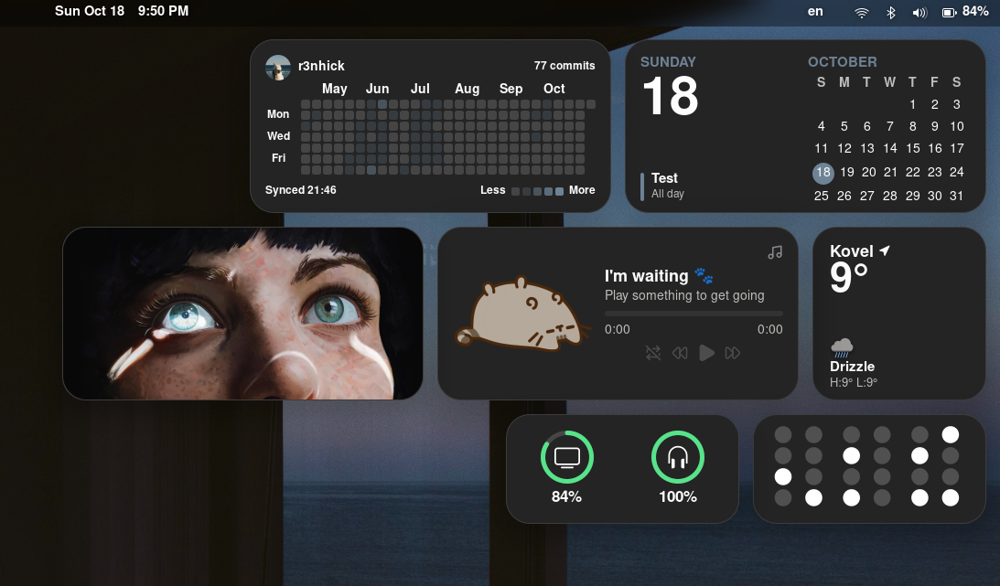


## ✨ Features

- **Grid layout** — widgets snap to a desktop grid and can be freely arranged in edit mode
- **Multiple sizes** — mini (2×1), small (1×1), medium (2×1), portrait (1×2), large (2×2), tall (2×4), wide (4×2), huge (4×4)
- **Edit mode** — add, move, resize, and remove widgets with visual feedback; bind a global shortcut to toggle it
- **Custom styling** — border radius, border width and color, background color, box shadow, and global opacity
- **Live updates** — most settings apply immediately without restarting GNOME Shell
- **Translations** — Ukrainian and Russian support

## 📦 Available Widgets

### ⏰ Time & Productivity

<table>
<tr>
<td width="80">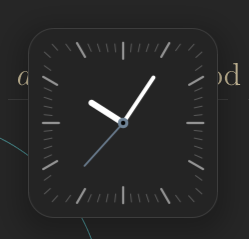</td>
<td><strong>Analog Clock</strong><br/>Classic analog clock with customizable appearance</td>
<td width="80"></td>
<td><strong>Digital Clock</strong><br/>Digital time and date display</td>
</tr>
<tr>
<td>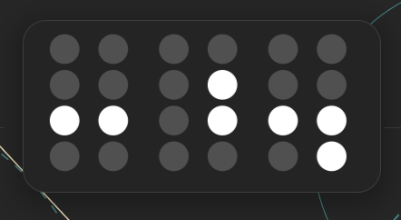</td>
<td><strong>Binary Clock</strong><br/>Time displayed in binary format for geeks</td>
<td></td>
<td><strong>Calendar</strong><br/>Monthly calendar with current day highlight</td>
</tr>
<tr>
<td>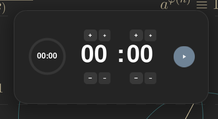</td>
<td><strong>Timer</strong><br/>Countdown timer with notifications</td>
<td>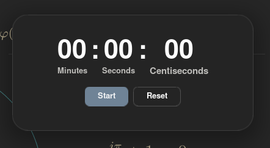</td>
<td><strong>Stopwatch</strong><br/>Elapsed time counter with controls</td>
</tr>
<tr>
<td></td>
<td><strong>Pomodoro</strong><br/>Pomodoro technique timer (25/5/15 min)</td>
<td>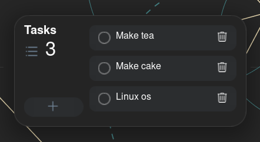</td>
<td><strong>Tasks</strong><br/>Simple todo list with checkboxes</td>
</tr>
<tr>
<td>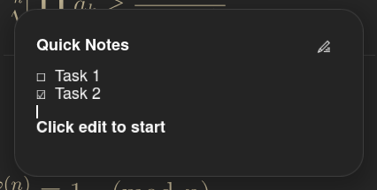</td>
<td colspan="3"><strong>Notes</strong><br/>Quick text notes widget with persistent storage</td>
</tr>
</table>

### 💻 System & Monitoring

<table>
<tr>
<td width="80"></td>
<td><strong>System Monitor</strong><br/>CPU, GPU, RAM, disk, and network usage</td>
<td width="80">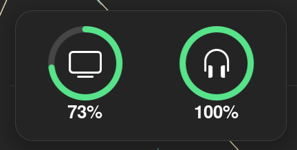</td>
<td><strong>Battery</strong><br/>Charge rings for devices</td>
</tr>
<tr>
<td></td>
<td colspan="3"><strong>Screen Time</strong><br/>Daily usage statistics and time tracking</td>
</tr>
</table>

### 🎵 Media & Content

<table>
<tr>
<td width="80">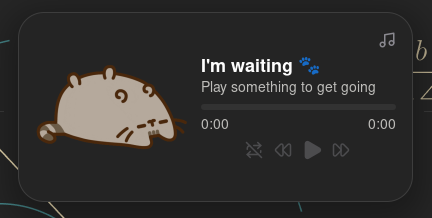</td>
<td><strong>Music</strong><br/>Now playing via MPRIS (any media player)</td>
<td width="80">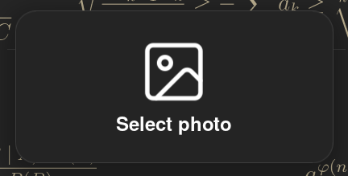</td>
<td><strong>Photos</strong><br/>Rotating photos from folders</td>
</tr>
<tr>
<td>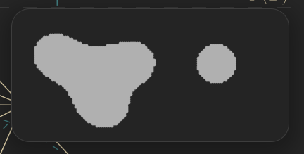</td>
<td colspan="3"><strong>Lava Lamp</strong><br/>Animated decorative lava lamp effect</td>
</tr>
</table>

### 🚀 Launchers & Integration

<table>
<tr>
<td width="80"></td>
<td><strong>App Launcher</strong><br/>Quick access to pinned applications</td>
<td width="80"></td>
<td><strong>Folder Launcher</strong><br/>Open folders in file manager</td>
</tr>
<tr>
<td></td>
<td><strong>GitHub</strong><br/>Profile stats and contribution graph</td>
<td>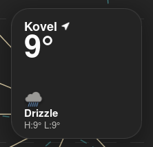</td>
<td><strong>Weather</strong><br/>Current conditions and temperature</td>
</tr>
</table>

## 🎯 Widget Details

### ⏰ Clock Widgets

#### Analog Clock
**Sizes:** Small, Medium, Large, Portrait

Classic analog clock with hour, minute, and second hands.

- Shows current time with smooth animations
- Customizable colors and appearance
- Multiple size options for different layouts

#### Digital Clock
**Sizes:** Small, Medium, Large

Digital time and date display with clean typography.

- 12/24 hour format support
- Date display with localization
- Configurable seconds display

#### Binary Clock
**Sizes:** Small, Medium, Large

Time displayed in binary format — perfect for developers and geeks.

- Binary representation of hours, minutes, seconds
- Color-coded rows
- Educational and unique

### 📅 Productivity Widgets

#### Calendar
**Sizes:** Small, Medium, Portrait, Large

Monthly calendar with current day highlight and week numbers.

- Current month view
- Today highlighted
- Week numbers displayed
- Click to navigate months

#### Tasks (Todo List)
**Sizes:** Medium, Portrait, Large, Tall

Simple and effective todo list with checkboxes.

- Add/remove tasks quickly
- Check off completed items
- Persistent storage across sessions
- Larger sizes for more tasks

#### Timer
**Sizes:** Medium

Countdown timer with visual progress indicator.

- Adjust time with +/- buttons (±1 and ±10 minutes/seconds)
- Two modes: setup (adjust) and running (countdown)
- Circular progress indicator
- Pause and reset controls
- Desktop notification when finished

#### Stopwatch
**Sizes:** Medium, Large

Elapsed time counter with start/pause/reset controls.

- Counts time upward from zero
- Large, easy-to-read display
- Start, pause, resume, reset buttons
- Shows hours, minutes, seconds, milliseconds

#### Pomodoro Timer
**Sizes:** Small, Medium

Pomodoro technique timer with automatic work/break cycles.

- 25 min work / 5 min short break / 15 min long break
- Automatic cycling through sessions
- Configurable durations
- Visual progress indicator
- Notifications for phase changes

#### Notes
**Sizes:** Medium, Portrait, Large, Tall

Quick text notes widget for jotting down ideas.

- Plain text editing
- Auto-saves as you type
- Persistent storage
- Scrollable for longer notes

### 💻 System Widgets

#### System Monitor
**Sizes:** Small, Medium, Large

Real-time system resource monitoring with sparklines.

- **CPU usage** — per-core or total
- **GPU usage** — if supported
- **RAM usage** — used/total memory
- **Disk usage** — used/total space
- **Network** — download/upload speeds
- Swipe or click to switch metrics
- Historical sparkline graphs
- Color-coded indicators

#### Battery
**Sizes:** Small, Medium, Large

Battery charge rings for your computer and Bluetooth devices.

- Main battery level with ring indicator
- Connected Bluetooth device batteries
- Charging status indicator
- Time remaining estimate
- Multiple device support

#### Screen Time
**Sizes:** Medium, Large

Daily application usage tracking and statistics.

- Tracks time spent in each application
- Shows most-used apps today
- Pie chart visualization
- Historical data
- Privacy-focused (local storage only)

### 🎵 Media Widgets

#### Music Player
**Sizes:** Medium, Portrait, Large

Now playing display with playback controls via MPRIS.

- Album artwork display
- Track title and artist
- Album name
- Play/pause and skip controls (if supported)
- Works with: GNOME Music, Rhythmbox, Spotify, VLC, Amberol, and most Linux media players
- Auto-hides when nothing is playing

#### Photos
**Sizes:** All sizes supported

Display rotating photos from selected folders or a single custom photo.

- Add multiple photo folders
- Auto-rotation through images
- Or set a single static photo
- Configurable rotation interval
- Supports common image formats
- Scales to fit any widget size

#### Lava Lamp
**Sizes:** Medium, Large

Animated decorative lava lamp effect for aesthetic desktops.

- Smooth blob animations
- Customizable colors
- Relaxing visual effect
- Pure eye candy

### 🚀 Launcher Widgets

#### App Launcher
**Sizes:** Medium, Large, Wide

Quick access grid for your favorite applications.

- Pin up to 16 applications
- Drag and drop to add apps
- Reorder by dragging
- Real application icons
- Single-click to launch
- Adaptive grid layout (2×2, 3×3, 4×4)

#### Folder Launcher
**Sizes:** Medium, Large

Quick access to frequently used folders.

- Add multiple folders
- Opens in your preferred file manager
- Real folder icons from filesystem
- Optional folder name labels
- Auto-detects file manager (Nautilus, Dolphin, Thunar, Nemo, etc.)
- Configure in widget settings

### 🌐 Integration Widgets

#### GitHub Activity
**Sizes:** Large, Wide

Display your GitHub profile statistics and contribution graph.

- Profile picture and bio
- Repository count
- Follower/following count
- Contribution graph for the past year
- Commit activity heatmap
- Caches data for offline viewing
- Configure username in settings

#### Weather
**Sizes:** All sizes supported

Current weather conditions and temperature.

- Uses GNOME Weather location settings
- Current temperature
- Weather condition icon
- Feels-like temperature
- High/low for today
- Auto-updates every 30 minutes
- Requires GNOME Weather app installed

## 🚀 Quick Start

### Installation

#### From source

```bash
git clone https://github.com/r3nhick/desktop-widgets.git
cd desktop-widgets
mkdir -p ~/.local/share/gnome-shell/extensions
cp -r . ~/.local/share/gnome-shell/extensions/desktop-widgets@r3nhick
```

Log out and log back in to restart GNOME Shell, then enable the extension via the Extensions app or:

```bash
gnome-extensions enable desktop-widgets@r3nhick
```

### First Steps

1. **Open Extension Settings**
   - Open the Extensions app (or `gnome-extensions-app`)
   - Find "Desktop Widgets" and click the settings icon

2. **Add Your First Widget**
   - Click "Add Widget" button
   - Choose a widget type from the dropdown
   - Click "Add" — the widget appears on your desktop

3. **Arrange Widgets**
   - Click "Arrange widgets" to snap everything to the grid
   - Or enable Edit Mode for free positioning

4. **Enter Edit Mode**
   - Press the keyboard shortcut (default: `Super+W`)
   - Or click "Toggle Edit Mode" in settings
   - Drag widgets around freely
   - Resize by dragging edges (if widget supports multiple sizes)
   - Press the shortcut again to exit

5. **Configure Widgets**
   - Each widget has its own settings row in the extension preferences
   - Click the widget settings icon to configure it
   - Changes apply immediately

### Keyboard Shortcuts

- **Super+W** (configurable) — Toggle Edit Mode
- Drag widgets in Edit Mode with mouse
- Snap to grid: use "Arrange widgets" button

## ⚙️ Configuration

### Global Settings

- **Grid size** — Cell width and height in pixels
- **Grid spacing** — Gap between widgets
- **Edit mode shortcut** — Keyboard binding to toggle edit mode
- **Opacity** — Global transparency for all widgets
- **Theme colors** — Background, border, and text colors

### Widget Styling

Each widget can be styled individually or use global theme:

- **Border radius** — Rounded corners (0-32px)
- **Border width** — Thickness of border (0-8px)
- **Border color** — RGBA color picker
- **Background color** — RGBA color picker with transparency
- **Box shadow** — Drop shadow effect with color, blur, and offset

### Per-Widget Settings

Most widgets have specific settings:

- **Clock widgets** — Time format, show seconds, colors
- **Weather** — Update interval, temperature units
- **Music** — Preferred player, show controls
- **Photos** — Rotation interval, photo folders
- **System Monitor** — Metrics to show, update interval
- **Timer/Pomodoro** — Custom durations
- **App/Folder Launcher** — Pinned items
- **GitHub** — Username, update interval
- **Tasks/Notes** — Font size, colors

## 📋 Requirements

- GNOME Shell 45+ (tested on GNOME 45, 46, 47)
- For Weather widget: GNOME Weather app installed
- For Music widget: Any MPRIS-compatible media player

## 🔄 Updating

To update to a newer version:

```bash
cd ~/.local/share/gnome-shell/extensions/desktop-widgets@r3nhick
git pull
```

Then log out and log back in to restart GNOME Shell.

If `git pull` fails due to local changes:

```bash
git reset --hard origin/main
git clean -fd
```

**Note:** This discards any local modifications.

## 🗑️ Uninstalling

Remove the extension:

```bash
rm -rf ~/.local/share/gnome-shell/extensions/desktop-widgets@r3nhick
```

Then log out and log back in.

To also remove all widget data (pinned apps, tasks, notes, screen time history, etc.):

```bash
rm -rf ~/.local/share/desktop-widgets@r3nhick
gsettings reset-recursively org.gnome.shell.extensions.desktop-widgets-r3nhick
```

## 🛠️ Development

### Project Structure

```
desktop-widgets@r3nhick/
├── extension.js          # Main extension logic, widget controller
├── prefs.js             # Settings UI
├── widgets/             # Widget modules
│   ├── clock/
│   ├── calendar/
│   ├── weather/
│   └── ...
├── utils/               # Shared utilities
├── schemas/             # GSettings schemas
├── locale/              # Translations
└── icons/               # Widget icons
```

### Adding a New Widget

1. Create `widgets/yourwidget/widget.js`:

```javascript
export const type = 'yourwidget';
export const label = 'Your Widget';
export const defaultSize = 'medium';
export const supportedSizes = ['small', 'medium', 'large'];

export function style(theme) {
  return `/* CSS for widget container */`;
}

export function render({body, theme, widget, settings}) {
  // Build your widget UI here
  // body is a St.BoxLayout
}
```

2. Register in `extension.js`:

```javascript
import * as YourWidget from './widgets/yourwidget/widget.js';

const WIDGET_MODULES = [
  // ... other widgets
  YourWidget,
];
```

3. Add to `prefs.js`:

```javascript
const WIDGET_TYPES = [
  // ... other types
  {type: 'yourwidget'},
];

const widgetTypeLabel = (type) => ({
  // ... other labels
  yourwidget: _('Your Widget'),
}[type] ?? type);
```

4. Add icon: `icons/widgets/yourwidget.svg`

5. Test: Log out and back in, add your widget from settings

### Building & Testing

Recompile schema after editing `schemas/*.gschema.xml`:

```bash
glib-compile-schemas schemas/
```

Update translations:

```bash
node tools/extract-strings.mjs
```

Watch logs:

```bash
journalctl -f -o cat /usr/bin/gnome-shell
```

## 🤝 Contributing

Contributions are welcome! Feel free to:

- Report bugs or request features via [GitHub Issues](https://github.com/r3nhick/desktop-widgets/issues)
- Submit pull requests with improvements or new widgets
- Translate the extension to your language
- Share screenshots of your desktop setup

When contributing:

- Follow the existing code style
- Test on GNOME Shell before submitting
- Update README if adding new features
- Add translation strings for new UI text

## 📄 License

This project is licensed under the [GNU General Public License v3.0](https://www.gnu.org/licenses/gpl-3.0.html).

See [LICENSE](LICENSE) for details.

## 🙏 Credits

- Original [Widgets extension](https://github.com/TheRealSourcer/widgets) by TheRealSourcer
- Maintained and extended by [r3nhick](https://github.com/r3nhick)
- Community contributors

---

Made with ❤️ for the GNOME community
